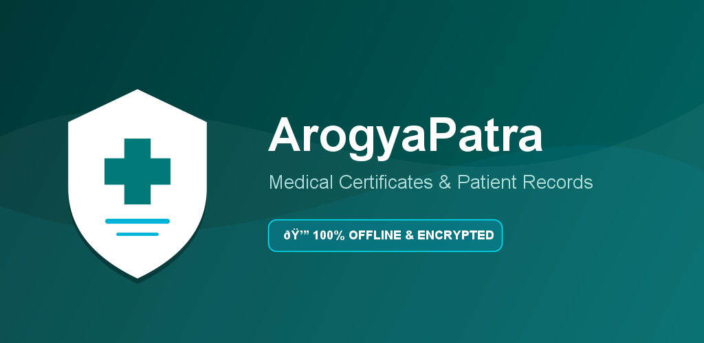

# ArogyaPatra (आरोग्यपात्र) 🏥

[](https://developer.android.com)
[](https://kotlinlang.org/)
[](https://developer.android.com/jetpack/compose)
[](https://m3.material.io/)
[](https://developer.android.com/training/articles/keystore)

**ArogyaPatra** is a privacy-first, 100% offline Android application designed for doctors, clinics, and healthcare professionals to create official medical certificates, manage patient records, and generate standardized A4 PDF documents.



---

## 🌟 Key Features

* 📜 **Instant Medical Certificate Generation**: Create Sick Leave, Medical Fitness, Referral, and customized medical certificates in seconds.
* 👨‍⚕️ **Patient Profile & Record Management**: Organized historical logs of patient demographics, diagnoses, prescriptions, and issued certificates.
* 🔒 **100% Local & Privacy-First**: All patient health data remains strictly on the user's device. Zero remote health server dependencies.
* 📄 **A4 PDF Export & Instant Printing**: Standardized PDF compilation with serial certificate numbers, clinic headers, signatures, and QR code verification via Android `FileProvider`.
* 🛡️ **AES-256 Encrypted Backups**: Export and restore database backups encrypted with AES-256-GCM using a user-managed private password.
* 🔑 **Biometric & PIN App Security**: Protect sensitive clinical records with Fingerprint/Face authentication and 4-digit PIN fallback.
* 📢 **Google AdMob & UMP Compliance**: Integrated Anchored Adaptive AdMob Banners gated behind Google User Messaging Platform (UMP) privacy consent.

---

## 🏗️ Architecture & Technology Stack

ArogyaPatra is built using modern Android development practices and Clean Architecture principles:

* **Language**: Kotlin `2.0.21`
* **UI & Layout**: Jetpack Compose with Material 3 design tokens
* **Architecture Pattern**: MVVM + Use Case + Repository Pattern with Kotlin Coroutines & Flow
* **Local Database**: Room DB (SQLite) with type converters and migration handling
* **Navigation**: Navigation Compose with type-safe screen routes
* **PDF Engine**: Native Android `PdfDocument` graphics canvas renderer
* **Monetization & Consent**:
  * Google Mobile Ads SDK `com.google.android.gms:play-services-ads:23.0.0`
  * Google UMP SDK `com.google.android.ump:user-messaging-platform:2.2.0`

---

## 📁 Project Structure

```text
ArogyaPatra/
├── app/
│   ├── src/main/java/com/aidwellness/arogyapatra/
│   │   ├── ads/              # AdMob Anchored Adaptive Banner & UMP Consent Manager
│   │   ├── backup/           # AES-256 Encrypted Backup & Restore Manager
│   │   ├── data/             # Room Database, Entities, DAOs, & Repository Layer
│   │   ├── domain/           # Use Cases (Generate Certificate, Patient Search)
│   │   ├── pdf/              # Native A4 PDF Generator & Canvas Renderer
│   │   ├── security/         # Biometric Auth & PIN Encryption Utilities
│   │   ├── ui/               # Jetpack Compose Screens, Components, & Navigation
│   │   └── MainActivity.kt   # Startup Navigation & UMP Initialization
│   └── build.gradle.kts      # App module build configuration & dependencies
├── upload-keystore.jks       # Release signing keystore (ignored by git)
├── key.properties            # Local signing properties (ignored by git)
└── README.md
```

---

## ⚙️ Building & Running

### Prerequisites
* **Android Studio**: Ladybug / 2024.2+
* **JDK Version**: Java 17
* **Compile SDK**: 35
* **Min SDK**: 24 (Android 7.0+)

### 1. Build Debug APK
```bash
./gradlew assembleDebug
```

### 2. Configure Release Signing
Create a `key.properties` file in the root project directory:
```properties
storeFile=upload-keystore.jks
storePassword=YOUR_KEYSTORE_PASSWORD
keyPassword=YOUR_KEY_PASSWORD
keyAlias=upload
```

### 3. Build Production Signed AAB & Release APK
```bash
./gradlew bundleRelease assembleRelease
```
Outputs will be generated at:
* **Production Signed AAB**: `app/build/outputs/bundle/release/app-release.aab`
* **Production Signed APK**: `app/build/outputs/apk/release/app-release.apk`

---

## 🛡️ Privacy & Compliance

* **Health Data Privacy**: ArogyaPatra does not collect, track, or transmit any patient medical data off-device.
* **Advertising & Identifiers**: Non-intrusive AdMob banner ads are displayed using Google's official Anchored Adaptive format and are requested only when Google UMP consent permits.
* **Privacy Policy**: [ArogyaPatra Privacy Policy](https://aidwellness.com/arogyapatra/privacy-policy)

---

## 📧 Support & Publisher Info

* **Developer / Publisher**: Aidwellness Health Tech
* **Website**: [https://www.aidwellness.in](https://www.aidwellness.in)
* **Support Email**: `support@aidwellness.com`
